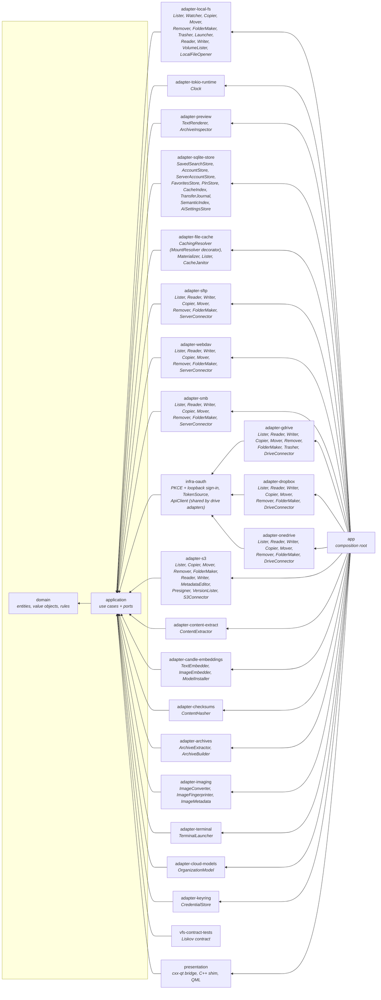

# Architecture

Dependencies point inward. `crates/arch-tests` fails the build if they don't (ADR 0001). Adapters may also use
the shared `infra-*` tier (OAuth and authenticated HTTP, ADR 0023), but never each other.

## Ports and their implementations (M1–M7)

| Port (application) | Implemented by | Proven by |
|---|---|---|
| `Lister` | `adapter_local_fs::LocalFs`, `application::testing::FakeVfs` | `vfs-contract-tests` via `adapter-local-fs/tests/contract.rs` and `vfs-contract-tests/tests/fake_vfs_contract.rs`; local-only cases in `adapter-local-fs/tests/local_fs.rs` |
| `Watcher` | `LocalFs` (notify: FSEvents / inotify), `FakeVfs` | same contract suite (`watcher_reports_create_and_remove`, `watch_missing_dir_is_not_found`) |
| `Copier`, `Mover`, `Remover`, `FolderMaker` | `LocalFs` (clonefile / chunked copy, no-replace rename), `FakeVfs` | `mutation_contract_tests!` (13 cases) for both; byte-copy and cancellation unit tests in `adapter-local-fs/src/mutation.rs` |
| `Trasher` | `LocalTrash` (macOS `NSFileManager`, freedesktop Trash 1.0), `FakeVfs` | `trash_contract_tests!` against the real platform trash and the fake; freedesktop layout unit tests |
| `Launcher` | `LocalFs` (`open` / `xdg-open`), `FakeVfs` | `application/tests/file_operations.rs::open_launches_the_item` |
| `JobObserver`, `ConflictResolver` | `presentation::job_reporting` (Qt thread), `testing::{RecordingObserver, ScriptedResolver}` | use-case tests in `application/tests/file_operations.rs` |
| `Materializer` | `LocalFs` (the file itself), `adapter_file_cache::CachedMaterializer` (every remote provider), `FakeVfs` | `application/tests/browse_and_find.rs::previews_are_routed_by_category` |
| `TextRenderer` | `adapter_preview::SyntectTextRenderer`, `testing::StubTextRenderer` | `adapter-preview/src/text.rs` tests (language detection, binary, truncation) |
| `ArchiveInspector` | `adapter_preview::LocalArchiveInspector`, `testing::StubArchiveInspector` | `adapter-preview/src/archive.rs` tests (tar, tar.gz, zip, unsupported) |
| `SavedSearchStore` | `adapter_sqlite_store::SqliteStore`, `testing::InMemorySavedSearches` | `adapter-sqlite-store/tests/saved_searches.rs` (persistence across reopen, ordering, corrupt rows) |
| `Clock` | `adapter_tokio_runtime::TokioClock`, `testing::InstantClock` | `adapter-tokio-runtime` unit test |
| `ProviderFactory` / `MountResolver` | `LocalFsFactory`, `adapter_s3::S3Service`, `ProviderRegistry` | `application::registry` tests |
| `Lister`, `Copier`, `Mover`, `Remover`, `FolderMaker` on S3 | `adapter_s3::BucketFs` | `adapter-s3/tests/s3_contract.rs` (lister, mutation, stream and resume suites plus multipart copy, 32 cases) against SeaweedFS in CI |
| `Reader`, `Writer` | `LocalFs` (hidden partial file + no-replace rename), `BucketFs` (PUT / multipart, `If-None-Match: *`), `SftpFs`, `DavFs`, `SmbFs`, `FakeVfs` | `stream_contract_tests!` (7 cases) for all; cross-provider use cases in `application/tests/across_providers.rs` |
| `Writer::resume`/`discard`, `WriteSink::checkpoint`, `Reader::read_from` | `LocalFs`, `BucketFs` (ListParts), `SftpFs`, `SmbFs`, `FakeVfs` (WebDAV: not resumable) | `resume_contract_tests!` (2 cases) for each; `application/tests/resume_servers_offline.rs` |
| `Lister`, `Copier`, `Mover`, `Remover`, `FolderMaker` on servers | `adapter_sftp::SftpFs`, `adapter_webdav::DavFs`, `adapter_smb::SmbFs` | `adapter-{sftp,webdav,smb}/tests/*_contract.rs` against OpenSSH, Apache `mod_dav` and Samba in Docker (32, 30 and 32 cases) |
| `ServerConnector`, `ServerAccountStore` | `SftpService`, `WebDavService`, `SmbService`; `SqliteStore`; `testing::{FakeServerConnector, InMemoryServers}` | host-key and sign-in cases in each contract file; `resume_servers_offline.rs`; `adapter-sqlite-store/tests/servers_cache_journal.rs` |
| Roles on cloud drives | `adapter_gdrive::DriveFs`, `adapter_dropbox::DropboxFs`, `adapter_onedrive::OneDriveFs` | `adapter-{gdrive,dropbox,onedrive}/tests/*_contract.rs` against `mock-cloud` (39, 33 and 33 cases, run by `cargo test`); `live_round_trip` (ignored) against the real services |
| `DriveConnector`, `DriveAccountStore`, `UrlOpener` | the three drive services; `SqliteStore`; `LocalOpener`; `testing::{FakeDriveConnector, InMemoryDrives}` | sign-in cases in each contract file; `application/tests/drives.rs`; `servers_cache_journal.rs` |
| `TransferJournal` | `SqliteStore`, `testing::InMemoryJournal` | `servers_cache_journal.rs` (survives reopen); `resume_servers_offline.rs` |
| `CacheIndex`, `PinStore`, `CacheJanitor` | `SqliteStore`, `adapter_file_cache::FileCache`; `testing::{InMemoryCacheIndex, InMemoryPins, RecordingJanitor}` | `adapter-file-cache/tests/cache.rs` (freshness, LRU eviction with pins, offline browsing, forgetting an account); `domain::cache` unit tests |
| `SemanticIndex`, `AiSettingsStore` | `SqliteStore` (int8 vectors searched in memory), `testing::{InMemorySemanticIndex, InMemoryAiSettings}` | `servers_cache_journal.rs` (survives reopen, model spaces kept apart, filters like the fake); `application/tests/semantic.rs` |
| `TextEmbedder`, `ImageEmbedder`, `ModelInstaller` | `adapter_candle_embeddings::{LocalTextEmbedder, LocalImageEmbedder, HuggingFaceInstaller}`, `testing::{FakeTextEmbedder, FakeImageEmbedder, FakeModelInstaller}` | installer unit test (resume, hash mismatch) against a local server; `tests/real_models.rs` (ignored, nightly): cross-lingual retrieval and text-to-photo |
| `ContentExtractor` | `adapter_content_extract::LocalExtractor`, `testing::FakeExtractor` | `adapter-content-extract/tests/formats.rs` (Office, OpenDocument, EPUB, HTML, RTF, PDF, encodings) |
| `IndexObserver` | `presentation::services::IndexStatusFeed`, `testing::RecordingIndexObserver` | `application/tests/semantic.rs` |
| `ContentHasher` | `adapter_checksums::StandardHasher`, `testing::FakeHasher` | known-answer unit test; `application/tests/utilities.rs` |
| `ArchiveExtractor`, `ArchiveBuilder` | `adapter_archives::LocalArchiver`, `testing::FakeArchiver` | `adapter-archives/tests/formats.rs` (round trip of every format with modes and times, zip-slip, RAR fixtures, encrypted RAR, system `7z`/`bsdtar` interop); `application/tests/utilities.rs` |
| `ImageConverter`, `ImageFingerprinter`, `ImageMetadata` | `adapter_imaging::LocalImageTools`, `testing::FakeImageTools` | `adapter-imaging/tests/images.rs` (orientation, all formats, EXIF sensitivity, lossless stripping keeping ICC, look-alike distances) |
| `PermissionEditor` | `LocalFs` (`chmod`), `SftpFs` (`setstat`), `FakeVfs` | `permission_contract_tests!` for all three (SFTP against OpenSSH in Docker) |
| `SecureEraser` | `LocalFs`, `FakeVfs` | `adapter-local-fs/src/erase.rs` tests; `application/tests/utilities.rs` |
| `TerminalLauncher`, `TerminalSession` | `adapter_terminal::AlacrittyLauncher`, `testing::FakeTerminalLauncher` | `adapter-terminal/tests/shell.rs` (real login shell: commands, colours, following only at the prompt, exit); key encoding unit tests |
| `TagEditor` | `LocalFs` (Finder tags / `user.xdg.tags`), `FakeVfs` | `tag_contract_tests!` for both; `adapter-local-fs/src/tags.rs` (Finder colours kept) |
| `OrganizationModel` | `adapter_cloud_models::HttpOrganizationModel`, `testing::ScriptedModel` | `adapter-cloud-models/tests/apis.rs` against `mock-cloud` (headers, schema, refusal, retries, fallback without `response_format`); `application/tests/organize.rs` |
| `CloudModelStore` | `SqliteStore`, `testing::InMemoryCloudModels` | `servers_cache_journal.rs` (survives reopen, clears) |
| `MetadataEditor`, `Presigner`, `VersionLister` | `BucketFs` | `application/tests/across_providers.rs` (use cases on the fake); manual check against SeaweedFS |
| `S3Connector` | `S3Service`, `testing::FakeS3Connector` | `across_providers.rs` (add/rollback, buckets by name, permission denied) |
| `AccountStore`, `FavoritesStore` | `SqliteStore`, `testing::{InMemoryAccounts, InMemoryFavorites}` | `adapter-sqlite-store/tests/accounts_and_favorites.rs` |
| `CredentialStore` | `adapter_keyring::KeyringStore` (Keychain / Secret Service), `testing::InMemoryKeychain` | `adapter-keyring/tests/os_keychain.rs` (`--ignored`, touches the real keychain) |
| `VolumeLister`, `LocalFileOpener` | `adapter_local_fs::{LocalVolumes, LocalOpener}`, `testing::{FixedVolumes, RecordingOpener}` | `OpenEntry` tests in `across_providers.rs`; volumes checked manually |
| `CostConfirmer` | `presentation::job_reporting::QtCostConfirmer`, `testing::ScriptedCosts`, `operations::AcceptCosts` (undo/redo) | `across_providers.rs` cost cases; `domain::cost` unit tests |

## Runtime flow: opening a folder

1. QML calls `FolderViewController.openLocation(text)`.
2. The controller records history and replaces its `FolderSession`. Dropping the old session cancels it.
3. The session subscribes through `WatchDirectory` and streams `ListDirectory` batches into `DirectoryViewModel`.
4. Sorted snapshots and row edits travel as `ModelUpdate`s through `CxxQtThread::queue` to the Qt thread, then into the C++ `EntryListModel`.

## Runtime flow: a file operation (M2)

1. QML calls `OperationsController.paste(locationId, Copy)`.
2. The controller reads file URLs from the system clipboard and starts a job with a `JobContext`: a throttled `QtJobObserver`, a `QtConflictResolver` and a cancel token.
3. `CopyEntries` scans the sources for totals, resolves name clashes by asking the resolver (with "apply to all"), copies through `Copier`/`FolderMaker`, and records the `Operation` in `OperationHistory`.
4. The watcher reports the new items to every open folder view. The job's end updates the undo/redo labels.

## Runtime flow: a cross-provider copy (M4)

1. Paste in an S3 folder: the controller takes `s3://` locations from the in-app clipboard (or `file://` URLs from the system one).
2. `CopyEntries` scans the sources, builds a `TransferEstimate` and asks `CostPolicy`; if it warns, `QtCostConfirmer` shows `CostDialog.qml` unless the account opted out.
3. Each item is routed: server-side `CopyObject` inside one bucket, otherwise `Reader` → `Writer` streaming (8 MiB multipart parts, 4 in flight).
4. S3 has no watcher, so when the job ends the controller emits `folders_changed` and open views of the affected folders reload.

## Runtime flow: resuming after a quit (M5a)

1. A copy or move job is recorded in the `TransferJournal` before it starts; a file of 16 MiB or more also records its writer's `ResumeState` once the writer can describe one.
2. The app quits mid-upload: the job future is dropped, the checkpointed sink keeps its partial data, and the journal row stays.
3. At the next start `checkInterrupted` finds the row and the window offers Resume or Discard.
4. `ResumeTransfer` reruns the job in "earlier run" mode: finished files are kept, existing folders are merged into, and the in-flight file continues at `Writer::resume`'s offset with `Reader::read_from`.

## Runtime flow: AI search (M6)

1. ✦ → *Turn On*: `EnableAiSearch` installs the text pack (verified download, f16 prep), saves the settings and
   tells the indexer through `IndexerControl`.
2. The indexer walks the scope, extracts text (`ContentExtractor`), embeds passages (`TextEmbedder`) and writes them
   to the `SemanticIndex`. It reports progress through `IndexStatusFeed` to `AiSearchController`.
3. A search in *Contents (AI)* mode: `parse_query` splits off dates and kinds, `SemanticSearch` embeds the rest,
   ranks text and image hits above their floors and fuses them, and the folder view shows them as a search session
   sorted by relevance.
4. File operations and *Look for Changes Now* send `rescan()`; otherwise the indexer looks again every 15 minutes.

## Runtime flow: extracting an archive on any provider (M7a)

1. *Tools → Extract Here*: `OperationsController.extract` starts a job (jobs panel, cancel, undo).
2. `ExtractArchive` gets a local copy through `Materializer` (the file itself, or a cached download) and creates a
   free folder (`photos`, `photos 2`, …) with `FolderMaker`.
3. `LocalArchiver` reads the archive on the blocking pool and streams `Folder`/`File`/`Chunk`/`EndFile` events
   through a bounded channel; each file goes to the destination's `Writer`.
4. The job records `Operation::Created([folder])`; undo trashes it.

## Runtime flow: the terminal (M7a)

1. `>_` shows `TerminalPane`; `TerminalController.open` calls `OpenTerminal`, which starts a login shell in the
   folder through `AlacrittyLauncher`.
2. Output wakes the controller (one queued redraw per burst); it takes a `TerminalScreen`, resolves colours for the
   theme, and pushes runs into the C++ `TerminalView`, which paints them.
3. Keys, input-method text, the wheel and the mouse come back as signals → `TerminalSession`.
4. Changing folders calls `follow`, which types a `cd` only while a shell leads the foreground process group.

## Runtime flow: organizing a folder (M7b)

1. *Tools → Organize…* opens `OrganizeWindow`; `OrganizeController.analyze` runs `AnalyzeFolder`: clutter rules
   and duplicates, then the cloud model (only for an opted-in folder with a key), then local rules and the local
   language model.
2. The user ticks suggestions; every change re-runs `domain::resolve`, and the window shows before → after.
3. *Apply* hands the resolved plan (JSON) to `OperationsController.applyOrganization`: an `ApplySuggestions` job
   creates folders, trashes, moves and renames, and tags, recorded as one `Organize` history entry.
4. *Undo Organize* runs the inverse sequence: tags back, items back, empty new folders trashed.

## Dependency injection without globals
`app` builds `AppServices` (use cases + runtime handle). `bootstrap.cpp` wraps them in a `ServicesHolder` QObject
and passes it to the root window as a required property. Each `FolderView` hands it to its controller.
