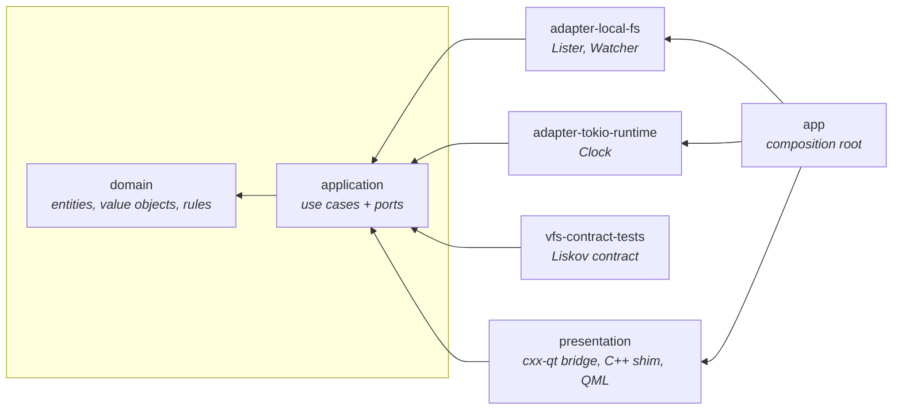

# Architecture

Dependencies point inward. `crates/arch-tests` fails the build if they don't (ADR 0001).

## Ports and their implementations (M1)

| Port (application) | Implemented by | Proven by |
|---|---|---|
| `Lister` | `adapter_local_fs::LocalFs`, `application::testing::FakeVfs` | `vfs-contract-tests` via `adapter-local-fs/tests/contract.rs` and `vfs-contract-tests/tests/fake_vfs_contract.rs`; local-only cases in `adapter-local-fs/tests/local_fs.rs` |
| `Watcher` | `LocalFs` (notify: FSEvents / inotify), `FakeVfs` | same contract suite (`watcher_reports_create_and_remove`, `watch_missing_dir_is_not_found`) |
| `Clock` | `adapter_tokio_runtime::TokioClock`, `testing::InstantClock` | `adapter-tokio-runtime` unit test |
| `ProviderFactory` / `MountResolver` | `LocalFsFactory`, `ProviderRegistry` | `application::registry` tests |

## Runtime flow: opening a folder

1. QML calls `FolderViewController.openLocation(text)`.
2. The controller records history and replaces its `FolderSession`. Dropping the old session cancels it.
3. The session subscribes through `WatchDirectory` and streams `ListDirectory` batches into `DirectoryViewModel`.
4. Sorted snapshots and row edits travel as `ModelUpdate`s through `CxxQtThread::queue` to the Qt thread, then into the C++ `EntryListModel`.

## Dependency injection without globals
`app` builds `AppServices` (use cases + runtime handle). `bootstrap.cpp` wraps them in a `ServicesHolder` QObject
and passes it to the root window as a required property. Each `FolderView` hands it to its controller.
